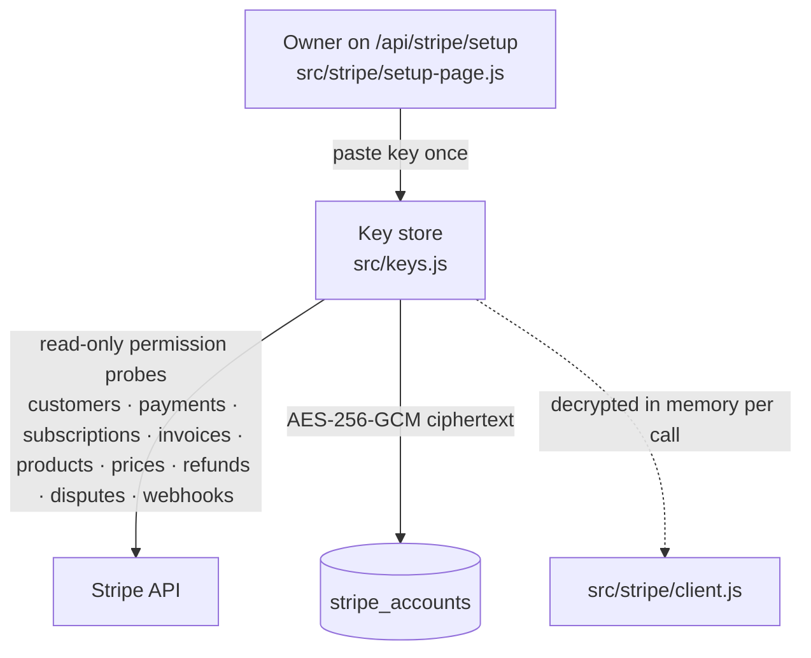

# 02 — Auth, Stripe keys, and tenancy

## Sign-in (OAuth issuer)

- This server is its own OAuth authorization server: authorization
  code + S256 PKCE (`src/core/oauth.js`, `oauth-handlers.js`), bearer
  auth on the MCP door (`src/core/mcp-auth.js`), dynamic client
  registration plus client-metadata documents (`src/core/cimd.js`;
  Muse's built-in client ID is `muse`), and per-client revocation
  (`src/core/oauth-revocation.js`, `api/oauth/revoke.js`).
- **Current live shape (honest):** the consent journey is the legacy
  protected owner page gated by the administrator passphrase, and only
  the service owner can sign in, with a Stripe test account. The
  corrected one-sign-in journey is verified live only in its CIMD
  client-ID-card component; the public self-enrollment flow is
  unfinished CAP-3/CAP-5 work (`docs/COMPLETION.md`).

## Stripe keys (the provider credential)

- No tool or MCP argument ever accepts a Stripe key; keys enter only
  through the setup page and are stored encrypted (`src/core/crypto.js`).
- Test keys are probed read-only before storage; the probe result is
  what the account record claims — nothing broader.
- **LIVE is a separate, owner-controlled activation** (two-step;
  `live_enable_intents` in the store): a stored test key never becomes
  a live key by itself, and `makeStripeClient` refuses a key whose
  mode does not match the request and refuses live keys outright on
  non-production deployments.

## Money-out gate

- Every AI-initiated money-out action (payouts, top-ups) needs a
  **signed-in owner approval** and is bounded by the shared
  **$500 / account / Denver-day** guard. Reservations and approvals
  are store rows (`money_reservations`, `money_approvals`,
  `owner_money_*_intents`), enforced in `src/money.js` and the write
  guard — not by prompt wording.

## Tenancy — INACTIVE source (CAP-3, not switched on)

- `src/tenancy/` (store, selection, vault) models person / organization
  tenants, membership revisions, non-executable Stripe account-grant
  descriptors, and a tenant-bound encrypted grant vault
  (`tenancy_secrets`, AES-256-GCM with context-bound AAD).
- It is initialized **only** behind
  `STRIPE_TENANCY_SCHEMA_APPROVED=enabled`, which is not activated in
  production; the vault reports `canExecute:false` and has no provider
  execution method. Legacy owner keys and OAuth accounts are untouched
  by it. See `docs/TENANCY-DATABASE.md`.
