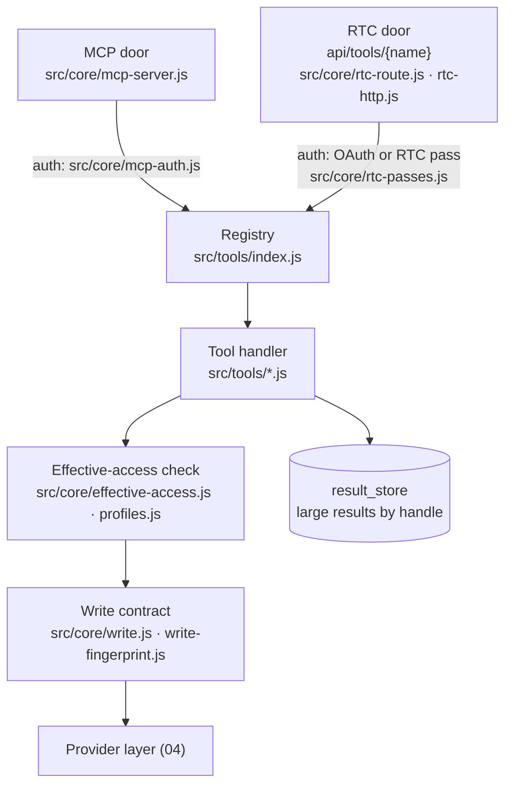

# 03 — Tools and the gateway pattern

## Registry

- `src/tools/index.js` merges every tool family module in `src/tools/`
  (119 modules) through `src/core/registry.js` (`mergeNamespaces`).
- The catalog is `docs/TOOL-CATALOG.md`; capability inventories are
  machine-checked (`npm run check:capabilities` — see 04).

## Two dispatch doors, one registry

- **Profiles:** connection profile (Full / Everyday / read-only) and
  account mode (test / live) decide which tools are listed and which
  writes are even attempted; `stripe_explain_access`
  (`src/tools/access.js`) explains the enforced result for the current
  connection — it is a diagnostic, never an escalation.
- **Write contract:** writes carry a fingerprint of what was approved
  (`write-fingerprint.js`, `write-contract-check.js`); a changed
  payload after approval does not execute. Money-out additionally
  passes the owner-approval + daily-cap gate in 02.
- **Idempotency:** provider writes derive a deterministic
  idempotency key (`rmcp_<tool>_<digest>` in `src/stripe/client.js`)
  from account, mode, tool and canonical arguments — a retry replays
  the same Stripe operation instead of duplicating it.
- **Change journal + undo:** writes land in `change_log`;
  `src/tools/undo.js` reverses recorded changes where Stripe allows.
- **Result rules:** oversized results are stored in `result_store`
  and delivered by handle (`/api/results/{handle}`).
