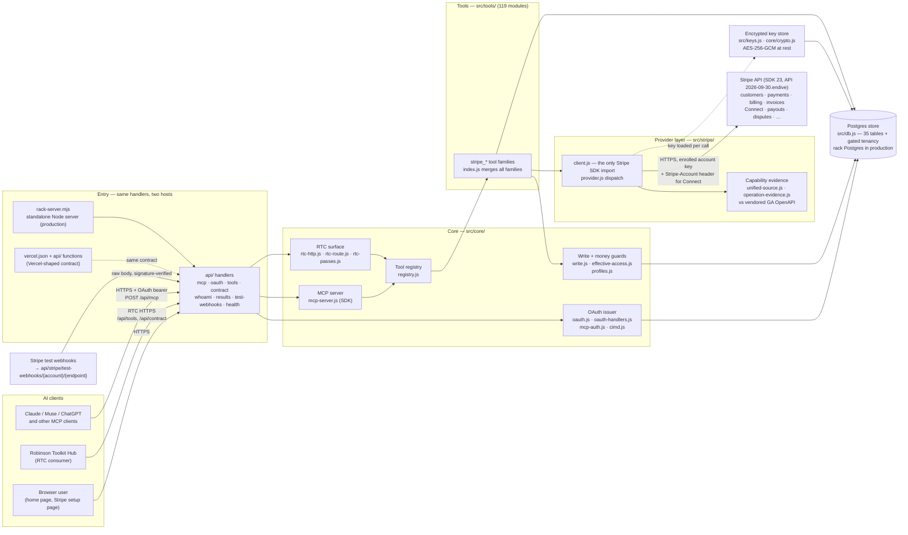

# Relational map — Stripe Unleashed (stripe-mcp)

A readable diagram of how the whole system connects: who calls whom,
what reads or writes what, and what depends on what. This is the map of
the **real, built system** — not the roadmap, and not provider
acceptance. When a feature is built or changed, this map is refreshed
in the same change (see `docs/RULES.md`).

- Pointer: `docs/MAP.md`
- Deep record: `docs/ARCHITECTURE.md` · Tool list: `docs/TOOL-CATALOG.md`
- Current state / what remains: `docs/STATUS.md`, `docs/COMPLETION.md`
- Honest status note: this server is deployed in **TEST-oriented
  development**; it is **not independently accepted for broad public
  or LIVE financial use** (see README).

## The system in one picture

## Area maps

| File | Area |
|---|---|
| [01-entry-and-clients.md](01-entry-and-clients.md) | Hosts, routes, and who connects |
| [02-auth-keys-and-tenancy.md](02-auth-keys-and-tenancy.md) | OAuth sign-in, Stripe key enrollment, LIVE/money gates, inactive tenancy |
| [03-tools-and-gateway.md](03-tools-and-gateway.md) | Tool registry, dispatch, write guards |
| [04-stripe-provider.md](04-stripe-provider.md) | The wrapped Stripe API surface, Connect, capability evidence |
| [05-storage-and-secrets.md](05-storage-and-secrets.md) | Postgres tables, encryption, reservations/approvals |
| [06-release-and-operations.md](06-release-and-operations.md) | CI, promotion to `live`, rack production, webhooks & dev simulation |

## Reading conventions

- **calls** — a runtime request from one part to another.
- **reads / writes** — data flow into or out of the store.
- **depends-on** — the part does not work without the other.
- A box named in backticks is a real file or route in this repo.
- Anything labelled **inactive source** exists in code but is not
  switched on in production — the map says so wherever it appears.
